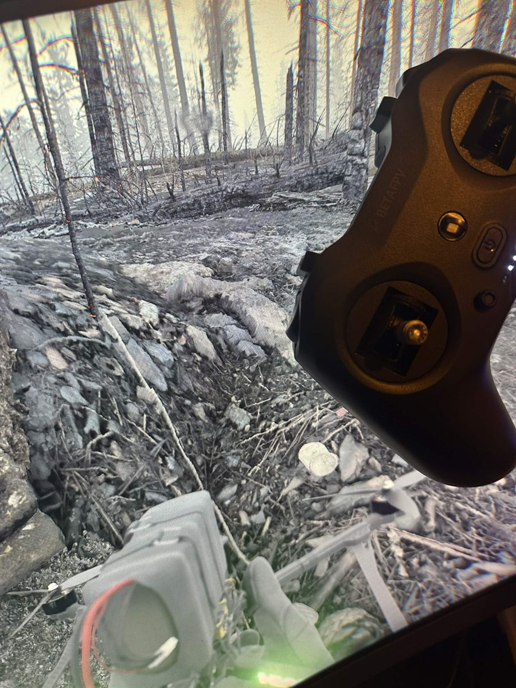
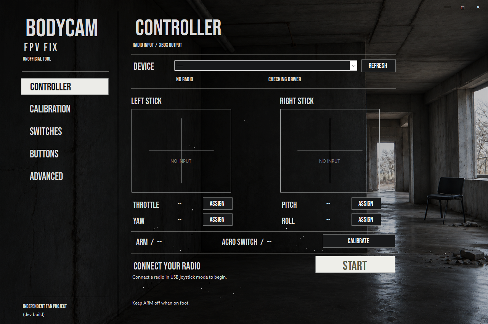
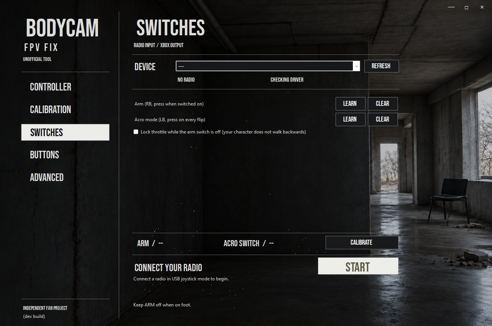
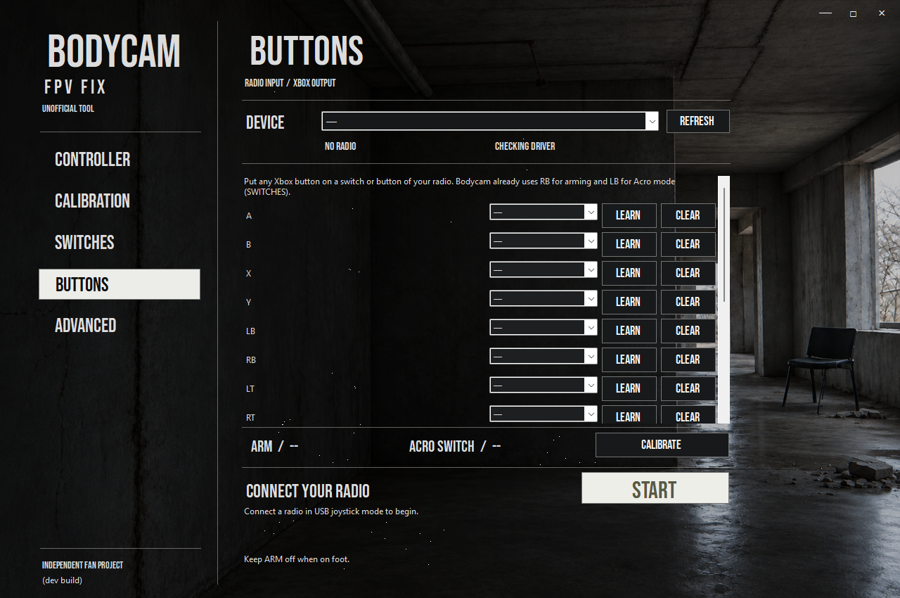
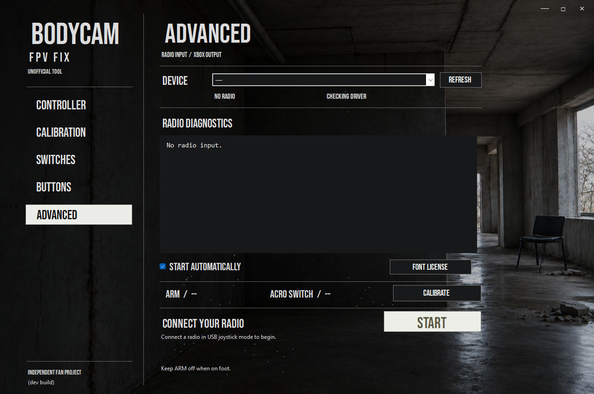

# Bodycam FPV Fix

**[View on Nexus Mods](https://www.nexusmods.com/bodycam/mods/66)**



**Use your FPV controller (RC transmitter) to fly the drone in Bodycam.** BETAFPV LiteRadio, RadioMaster, Jumper, TBS, DJI and other EdgeTX or OpenTX radios: plug the radio in by USB, start one exe and fly with real sticks instead of a gamepad.

Bodycam only understands Xbox controllers. Bodycam FPV Fix reads your radio over USB and turns it into a virtual Xbox controller with the stick layout that Bodycam's Acro mode expects: throttle and yaw on the left stick, pitch and roll on the right. Two switches on your radio arm the drone (RB) and toggle Acro mode (LB). Any other Xbox button can go on any switch or button of the radio, and a calibration wizard corrects off-center sticks and short stick travel.



| Switches | Buttons | Advanced |
|---|---|---|
|  |  |  |

**Guide:** [English](docs/GUIDE.md) · [Deutsch: Bodycam-Drohne mit FPV-Funke fliegen](docs/ANLEITUNG.md)

## Download

> [!IMPORTANT]
> **Bodycam FPV Fix is only published here on GitHub ([releases](https://github.com/lukas-Logikfabrik/bodycam-fpv-fix/releases)) and on [Nexus Mods](https://www.nexusmods.com/bodycam/mods/66).** Copies from other sites, re-uploads and builds from forks of this repository do not come from us and can contain anything. How to check your copy without extra tools: [Is this safe to run?](#is-this-safe-to-run)

**[Download the latest release](https://github.com/lukas-Logikfabrik/bodycam-fpv-fix/releases/latest)**: take `BodycamFpvFix-v….zip`. It contains the program and the official ViGEmBus driver installer, needs no installation and runs on Windows 10 and 11. Extract the whole zip first (right-click → **Extract All…**), then start `BodycamFpvFix.exe` from the extracted folder.

Already have the ViGEmBus driver (for example from DS4Windows)? Then the single [BodycamFpvFix.exe](https://github.com/lukas-Logikfabrik/bodycam-fpv-fix/releases/latest/download/BodycamFpvFix.exe) is enough.

## Quick start

1. Connect the radio by USB. If the radio asks for a USB mode, choose **USB Joystick (HID)**.
2. Extract the zip and start `BodycamFpvFix.exe`. On the first start it runs the included ViGEmBus driver installer; confirm the Windows admin prompt once and click through the installer.
3. Tab **CALIBRATION**: move the sticks, the bars should follow. If an axis is wrong or reversed, click **Learn** next to it and follow the prompt. Click **Calibrate** once and follow the two steps.
4. Tab **SWITCHES**: click **Learn** next to Arm and flip your arm switch on. Do the same for Acro mode. (Preset for the BETAFPV LiteRadio: SA and the rightmost switch.)
5. Optional, tab **BUTTONS**: put more Xbox buttons on switches, for example to leave the drone.
6. Click **Start** and leave the window open while you play.

In Bodycam: take out the drone, flip the Acro switch, put the throttle down and switch Arm on. Keep Arm on while you fly and switch it off when you are back on foot.

> [!WARNING]
> **Keep the Arm switch OFF whenever you are on foot.** While Arm is on, the throttle stick goes to the game, and Bodycam reads it on foot as well: with the throttle down, your character walks backwards and keeps walking. Switch Arm on only after you have taken out the drone, and off again as soon as you are back on foot, also after a crash. While Arm is on, the program shows a red warning.

## Is this safe to run?

- **All source code is in this repository.** The exe in the releases is built by [GitHub Actions](.github/workflows/build.yml) from exactly this code, not on anyone's PC.
- **Only the [releases](https://github.com/lukas-Logikfabrik/bodycam-fpv-fix/releases) here and [Nexus Mods](https://www.nexusmods.com/bodycam/mods/66) are official.** Anyone can copy open source code, so a file from somewhere else, or built from a fork, may have been changed.
- **Check your copy, no extra download needed.** Open the folder with `BodycamFpvFix.exe`, type `powershell` into the address bar of the folder window and press Enter. Then run:
  ```
  (Get-FileHash .\BodycamFpvFix.exe).Hash
  ```
  The result must match *SHA-256 of BodycamFpvFix.exe* on the [release page](https://github.com/lukas-Logikfabrik/bodycam-fpv-fix/releases) of your version. The exe inside the zip is the same file as the single exe, so this works for every download. If it does not match, delete the file.
- **Every release also has a GitHub build attestation.** With the [GitHub CLI](https://cli.github.com/) you can additionally check that your download was built by this repository:
  ```
  gh attestation verify BodycamFpvFix.exe --repo lukas-Logikfabrik/bodycam-fpv-fix
  ```
- **The program runs with normal user rights.** Admin rights are only needed once, to install the ViGEmBus driver. When the driver is missing, the program starts the official, signed installer from the zip's `driver` folder (unchanged from the [ViGEmBus release page](https://github.com/nefarius/ViGEmBus/releases/tag/v1.22.0)) after checking its SHA-256.
- **It reads your radio and nothing else.** No network access at all (since v1.1.0). It writes only its settings to `%APPDATA%\BodycamFpvFix`.
- **The exe is not code-signed.** Chrome may say the file is not commonly downloaded (choose **Keep**), and Windows SmartScreen may warn on first start (**More info → Run anyway**). Both warnings are about new, unsigned files, not about anything found in it.
- **VirusTotal:** [8 of 71 engines](https://www.virustotal.com/gui/file/1e7f1af52e2eb2f258992c1a750869e5316e1a7d494be43b8c04e317c948a4b1) flag v1.0.1. All eight give generic machine-learning or reputation verdicts (for example "Unsafe", "malicious_confidence_90%", or McAfee's "Ti!" label for files it has not seen before), and none names a known malware family. Microsoft Defender, Kaspersky, ESET, Bitdefender, Avast, Malwarebytes, Sophos, Symantec and Trend Micro report it clean. What the heuristics react to is all visible in the source: the exe is new and unsigned, v1.0.1 downloaded and started the ViGEmBus installer when the driver was missing (v1.1.0 no longer downloads anything), and the ViGEm client library unpacks its native `vigemclient.dll` at runtime.

## Which radios work?

Any radio that shows up on the PC as a USB joystick, for example:

| Radio | Status |
|---|---|
| BETAFPV LiteRadio (USB ID `0483:572B`, "BETAFPV Joystick") | **Tested**, works out of the box including the switch mapping |
| RadioMaster Pocket (EdgeTX, "Radiomaster Pocket Joystick") | **Tested** by a user, works after calibration. The switches come in as axes: set Arm and Acro with **Learn** (for example `Ry>1023`) |
| EdgeTX / OpenTX radios (RadioMaster TX16S, Boxer, Zorro, TX12, Jumper, FrSky, ...) | Should work. Pick "USB Joystick (HID)" when you plug in, then use **Learn** |
| TBS Tango 2 / Mambo | Should work, use **Learn** |
| DJI FPV Remote Controller 2/3 in joystick mode | Should work, use **Learn** |

Tested so far: BETAFPV LiteRadio and RadioMaster Pocket. If you try another radio, please fill in a short [radio report](https://github.com/lukas-Logikfabrik/bodycam-fpv-fix/issues/new?template=radio-report.yml), whether it worked or not. Every report goes into this table.

## Bodycam settings that help

Bodycam's default drone rates are very high (RC Rate 2.0, which is about 1100°/s at full stick). In **Settings → Drone**, these values feel like a normal freestyle quad:

| Setting | Bodycam default | Suggested |
|---|---|---|
| Pitch / Roll / Yaw RC Rate | 2.0 | 1.0 |
| Super Rate | 0.64 – 0.69 | 0.65 |
| RC Expo | 0.22 – 0.24 | 0.15 |
| Camera tilt | 10° | 25° |

## Troubleshooting

| Problem | Fix |
|---|---|
| Your character walks backwards by itself | The Arm switch is still on, so the throttle stick goes to the game. Switch Arm off while you are on foot. |
| The drone or camera keeps rolling or turning by itself | Click **Calibrate** on the CALIBRATION page. If a stick still shows a large value while centered, the radio itself sends its end position: calibrate the radio (see its manual), then calibrate again here. |
| Bodycam shows 50 % throttle with the stick down | The arm switch is off, so the throttle is locked at center. Switch Arm on. |
| Left stick moves the drone forward/back, right stick moves the camera | The drone is in Bodycam's normal mode. Flip the Acro switch (LB). |
| The program says the driver installer was not found | You started the exe from inside the zip, or only downloaded the single exe. Extract the whole zip and start the exe from there, or install ViGEmBus 1.22.0 from its [release page](https://github.com/nefarius/ViGEmBus/releases/tag/v1.22.0). |
| Radio is not in the list | Switch the radio to USB joystick mode. The program finds it within two seconds; **Refresh** looks right away. |
| Nothing happens in the game | The status line must say "Running". Close other controller tools such as x360ce or DS4Windows so only one virtual controller exists. |

## FAQ

**Can I use my FPV controller or RC transmitter in Bodycam?**
Not on its own: Bodycam only reads Xbox controllers. With Bodycam FPV Fix you can, as long as the radio shows up on the PC as a USB joystick.

**Does it work with RadioMaster (TX16S, Boxer, Pocket, Zorro), Jumper, TBS or DJI radios?**
It should, see [Which radios work?](#which-radios-work). The RadioMaster Pocket and the BETAFPV LiteRadio are tested.

**Do I need a real drone, Betaflight or a receiver?**
No. You only need the radio and a USB data cable. Nothing gets bound or flashed.

**Does it change the game?**
No. It does not touch Bodycam's files or memory. Windows simply sees one more Xbox controller, created through the same ViGEmBus driver that tools like DS4Windows use.

**Why does my character walk backwards?**
The Arm switch is on, so the throttle stick goes to the game. Switch Arm off while you are on foot (see the warning under [Quick start](#quick-start)).

**Mac, Linux or Steam Deck?**
No, only Windows 10 and 11, because the virtual controller needs the ViGEmBus driver.

## How it works

The program reads the radio's HID reports directly (all axes and buttons), maps them and sends them to a virtual Xbox 360 controller created through the [ViGEmBus](https://github.com/nefarius/ViGEmBus) driver. What Bodycam expects, measured in the game:

- Left stick Y over its full travel is throttle: down = 0 %, center = 50 %, up = 100 %.
- Right stick Y negative is pitch forward.
- RB arms the drone, LB toggles Acro mode. The arm switch sends RB only when it is switched on, so radio and game stay in step after a crash.
- While the arm switch is off, the left stick is held at center so your character does not walk backwards on foot. While it is on, nothing holds it back, hence the warning above.
- Extra buttons have three modes: **Hold** (pressed while the switch is on), **Tap on every flip** (for things the game toggles) and **Tap when switched on**.
- Calibration stores the center and both end positions of each stick. Without it, the program uses the range the radio reports and measures the centers when you press Start.

Settings are saved per radio in `%APPDATA%\BodycamFpvFix\settings.json`.

## Build from source

Requirements: Windows with .NET Framework 4.8 and Visual Studio 2022 or the Visual Studio Build Tools (for the C# compiler).

```
powershell -ExecutionPolicy Bypass -File build.ps1 -Version 1.0.0
```

The exe, the release zip and their checksums land in `dist\`. The build downloads `Nefarius.ViGEm.Client` 1.21.256 and the build tool `ILRepack` 2.0.48 from NuGet and the ViGEmBus 1.22.0 installer from its GitHub release, checks all SHA-256 values, merges the ViGEm library into the exe and packs the zip.

## License

MIT, see [LICENSE](LICENSE). Uses the ViGEm.NET client (MIT) and the ViGEmBus driver (BSD-3-Clause) by Nefarius Software Solutions, see [THIRD-PARTY-NOTICES.md](THIRD-PARTY-NOTICES.md). Both ViGEm projects are retired by their author but still work.

Bodycam FPV Fix is a fan project. It is not affiliated with Reissad Studio (Bodycam), BETAFPV or any other radio maker.
